# Operating loops

The loops Spice runs and the state machines they keep. Contracts with a home in
the [invariant register](invariants.md) are linked, not restated.

---

## L-TASK — the unit of work

**Intent.** A task moves through named phases, and every accepted advance is a
journal fact. [Claims and allocation](invariants/identity.md#work-claims-and-allocation)
govern who holds it.

Stored workflow status is one small machine:

```mermaid
stateDiagram-v2
  direction LR
  [*] --> pending: task&#58;&#58;added
  pending --> completed: accepted final phase, close, or conclusion
  pending --> deleted: task&#58;&#58;deleted
  completed --> [*]
  deleted --> [*]
```

Claim disposition is a second, independent machine:

```mermaid
stateDiagram-v2
  direction LR
  [*] --> active: claim&#58;&#58;won
  active --> freed: claim&#58;&#58;freed
  active --> lapsed: claim&#58;&#58;lapsed
  freed --> [*]
  lapsed --> [*]
```

Renewal, carry, and rebound preserve an active claim. Steal either fills an
open slot without displacement or lapses the newest active claim before winning:

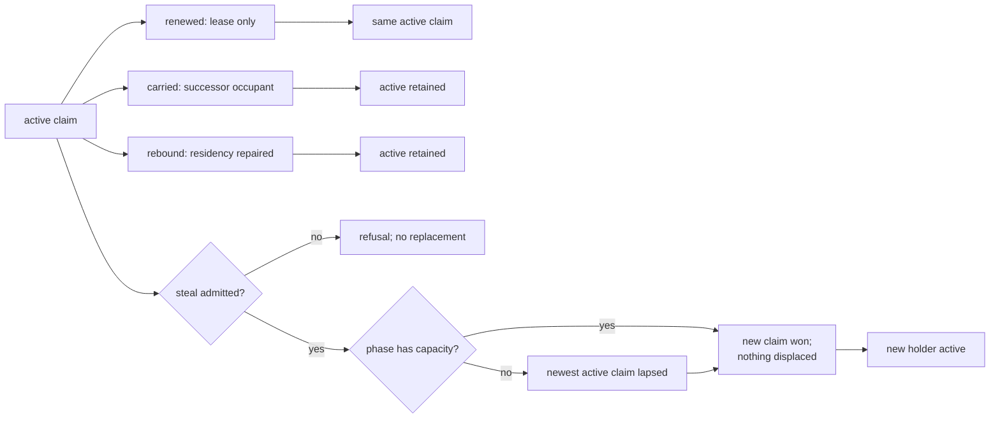

Readiness and possession are projections over those heads, not extra states in
either machine:

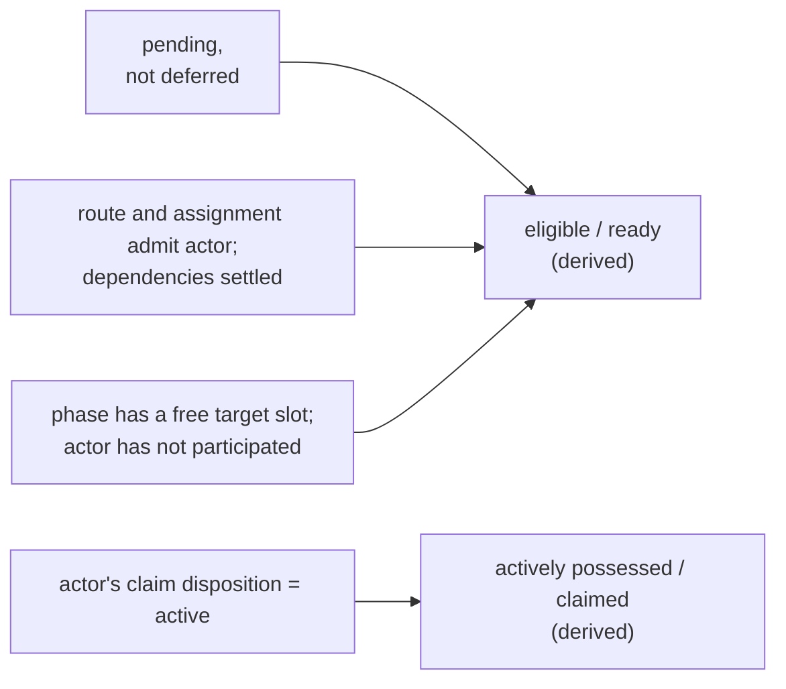

Landing is the Git consequence of one class of accepted advance, never a stored
workflow or claim state; the [integration boundaries](model/boundaries.md#the-three-lane-integration-git-boundaries)
govern it:

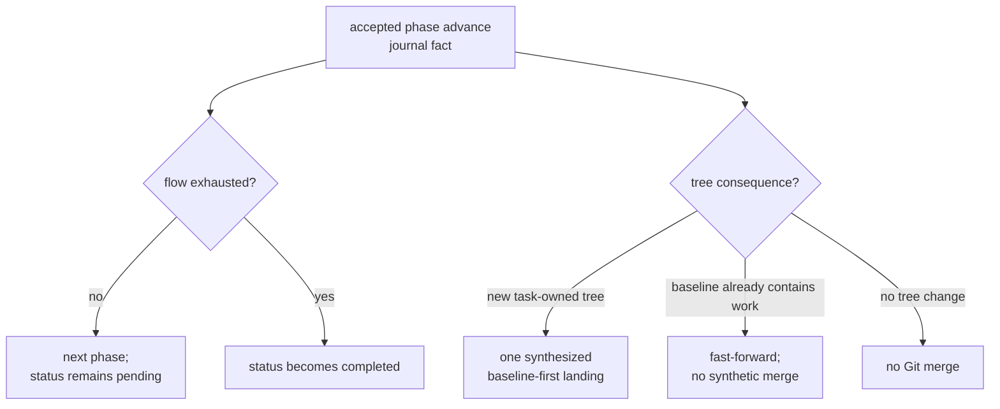

Voluntary release is one guarded Git-and-journal transition:

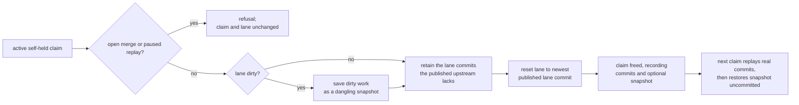

**Invariants**

- Workflow statuses are `pending`, `completed`, `deleted`; claim dispositions
  are `active`, `freed`, `lapsed`. Deferral, dependency blocking, readiness,
  possession and landing are projections.
- Release parks commits absent from published upstream, or after the claim-time
  head without upstream, plus tracked, staged and non-ignored untracked dirt.
  Parked objects have no stash or preservation ref; a pruned object refuses the
  next claim without changing board or lane.
- Claims replay commits oldest first, then restore the snapshot without committing
  it. The restored delta remains staged, or unmerged on conflict. At that owned
  handoff, snapshot replay retires its synthetic Git controls without changing
  HEAD, the index, or claimant files. A conflicting real commit pauses replay;
  the snapshot waits until completion retries.
- Resolve snapshot conflicts and `git add` the chosen content. If the resulting
  tree is already HEAD and the worktree is clean, retry task completion without
  manufacturing a commit. Any remaining delta needs an explicit commit through
  the ordinary pre-commit gate; the parked snapshot object is never an admitted
  task commit.
- Snapshot replay records its input, HEAD and Git configuration first. An
  interruption between the pick and its cleanup seal is recovered by
  reconstructing the expected controls in an isolated Git directory and
  corroborating them; the delta is never replayed into claimant files, and
  changed HEAD, configuration or foreign controls refuse.
- Failed snapshot cleanup keeps its pending identity and installed content; fix
  the filesystem failure and retry the task boundary, and cleanup resumes
  without replaying the settled delta. If claim preparation failed before a
  claim was granted, resolve and stage conflicts, then `spice task capture
  HANDLE` that parked task: sealed recovery preserves staged, unstaged and
  untracked content, accepts a resolution already equal to HEAD, and never
  replays the snapshot twice. `task next` refuses this pending handoff; use the
  named capture recovery first.
- Do not delete unknown controls or fabricate allocator merge authority. A failed
  pick with no conflicts retains its input and requires a clean worktree to retry.
- `task free`, self-deferral and plan completion park work. Peer deferral changes
  scheduling, never possession; deferring another holder's open Design
  [asks it to free](invariants/identity.md#work-deferral-stops-an-open-design).
- A refused guarded write restores claim and lane, including staged/worktree
  separation.
- Existing-task capture, new-task capture, and `--steal` acquire work through
  the [captured-work](invariants/identity.md#work-captured-commits-enter-owned-implementation-atomically)
  and [phase-target](invariants/identity.md#work-a-phase-target-seats-distinct-lanes)
  contracts. Capture creation flags never modify an existing task.
- `task join` and invitations fill free phase slots under that same phase-target
  contract. One claim has at most one live, expiring offer; accepting joins,
  declining settles it, and either allows a replacement. Joining is not
  completion: each participant finishes its own share, and the last required
  Design arrival completes the shared pass for operator decision.
- Before guarded adoption, seal and quarantine dirty paths; synchronization
  retains loose commits. Quarantine also removes each directory its untracked
  paths leave empty, and restore or replay recreates it; a parent that became a
  link or a file refuses. A quarantine that cannot finish cleaning restores
  what it sealed. Clean-lane and recovery checks share one read of staged,
  unstaged and non-ignored untracked paths that never writes the index: empty
  directories and directories containing only ignored paths remain clean even
  if Git's optional untracked cache names them.
  Success replays the exact staged, unstaged and non-ignored untracked
  generation. Interrupted adoption resumes only through `task capture` for its
  sealed target.
- `task capture --restore` never rewinds history. At sealed HEAD it restores the
  pre-claim generation; at a descendant of sealed HEAD and any synchronized
  boundary, it replays that generation as unowned dirt, resuming only onto its
  starting HEAD. Already-present edits or replay conflicts retain sealed objects
  outside the pending slot. Divergence or generation mismatch refuses without
  deleting quarantine.
- Unowned-path/loose-commit refusals name both recovery forms. Planning and
  Design claims refuse implementation adoption before quarantine or claim.
- Every phase transition is a journal fact on the board, even one that
  changes no tree. A landing commit's subject scope is the root of the task
  topic, while its sorted trailers carry `Task-Phase`, `Task-Stamp`, and
  `Task-Topic`; first-parent history records mutating landings, not every
  transition.
- Work controls project current tasks into durable `#/work...` links over Chat;
  the [task overview](../app/OVERVIEW.md#task-overview) owns their grammar.
  Topic-wide, task, relationship, and composed selections stay browser-local.

Task statement and draft rules live in [statements.md](statements.md).

---

## L-STEER — intent made durable

**Intent.** After journal acceptance returns a live durable key, operator intent
survives failures until ACK, NAK, cancellation, lapse, or dead-lettering retires
it; recovery may return lapsed and dead-lettered intent to `live`. Before that
boundary, the browser-local queued or sent prediction remains ephemeral and
reconciles against the current pending inbox after durable settlement. The
[steering register](invariants/identity.md#steering) states delivery,
answering, escalation, and recovery.

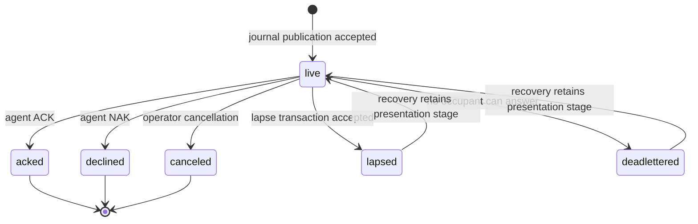

---

## L-AGENT — the work-availability loop

**Intent.** Lifecycle seats one vacant lane when eligible work warrants it.
A clean turn without a retained claim vacates; an exact active, unparked claim
may retain the same command driver idle for its next serialized continuation.
Operator wake remains available, including for Drain lanes.

The detached supervisor records the lifetime of one occupant process:

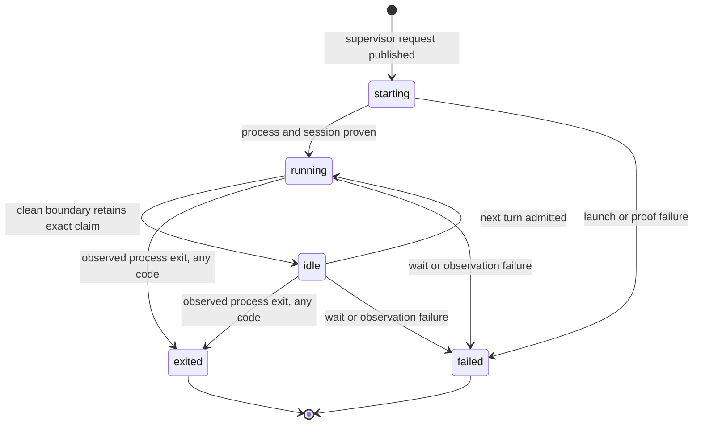

The UI derives lane status independently; pending direction that can wake the
lane outranks liveness:

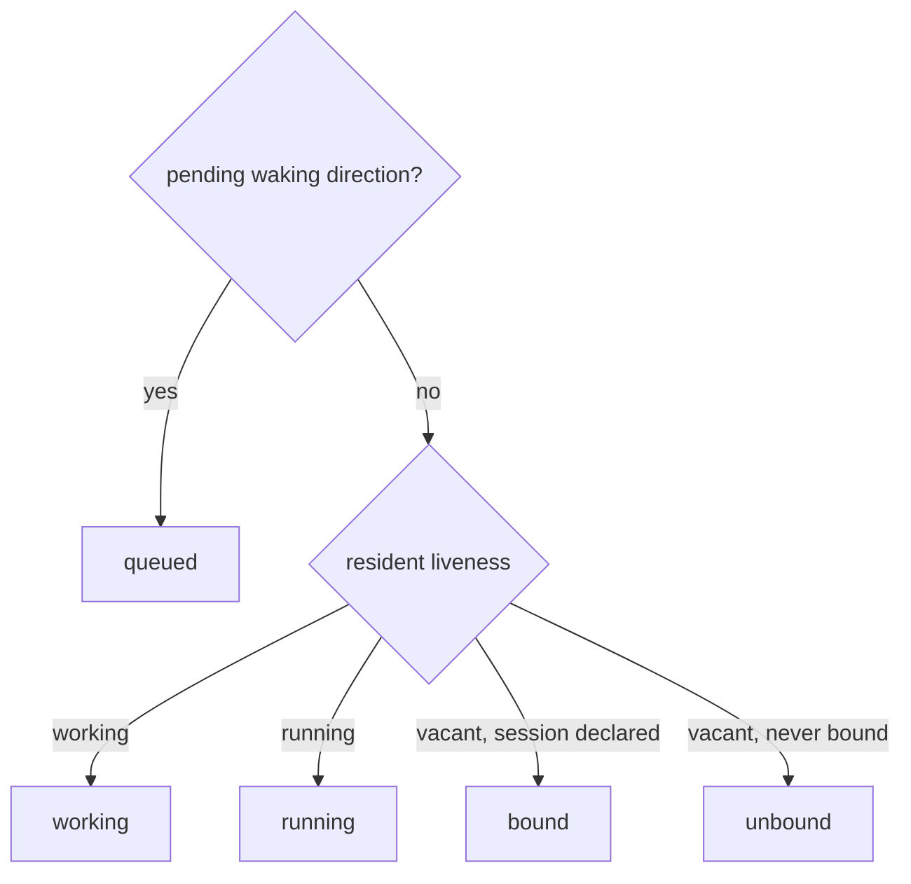

Parking is a separate channel from that status: the lane read carries why the
resident holds back a lane's automatic work, and a parked pip is hollow in
whatever colour its status wears.

Resident lifecycle is a third vocabulary; resident replacement may move directly
to `dark` while detached supervisors remain live:

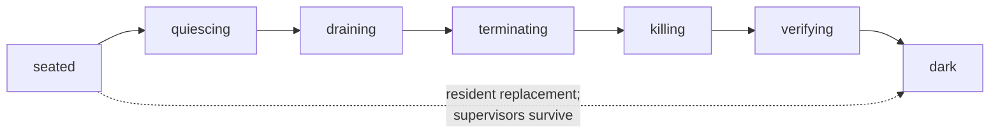

The wake decision:

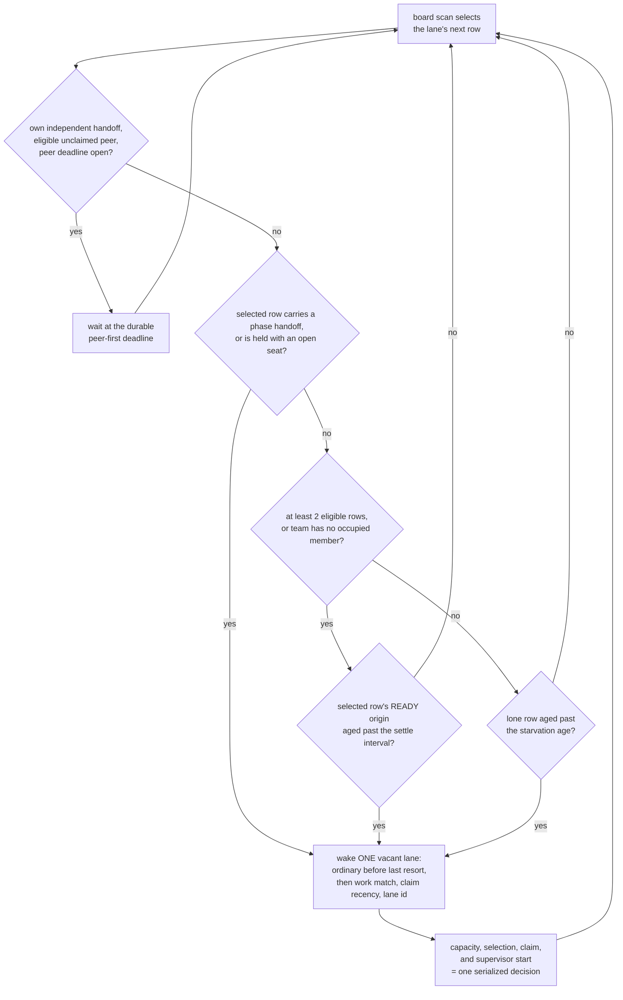

**Invariants**

- Supervisor phase, UI lane status, and resident lifecycle are separate
  vocabularies and do not form one machine.
- A clean turn boundary with an exact active, unparked claim leaves the same
  occupant idle, then schedules one private held-claim continuation. Every later
  clean boundary does the same while that claim remains active. Task authority
  admits the claim before its one native-input catch-up. Clearing the phase
  frees the claim, so completed work does not wake again. Trust and Design holds
  park the continuation; before continuing, the boundary parks a claim whose
  worktree needs an ungranted configuration, as an occupant exit does. An
  unfinished deadline-bounded kept job holds it until
  the job ends or reaches its admitted expiry; services hold nothing. Initial
  assignment and native room, steering, task, phase, and job input keep their
  own delivery authority. No claim, an idle owner mismatch, or process exit
  vacates the lane.
- The held-claim continuation is deliberately level-triggered: an active claim,
  not new input, decides whether a lane must work, so it repeats after every
  clean turn as the signal to finish, free, or defer the claim. An edge-only
  continuation strands work whenever a turn ends on a reply to an interjection.
  Its text escalates per claim and names task and grant waits before `defer`.
- No supervisor request is published until the lane's worktree is admitted as a
  root inside the resident's own Git common directory. A lane naming another
  repository's worktree parks with a refusal; the resident and its other lanes
  continue.
- Automatic work wakes require the lane's team to have drain enabled and to
  own the task under the same config snapshot used by `task next`. Named
  reservations precede ordinary rule specificity, except in review phases.
  Pausing drain does not release a reservation. Inbox and held-claim wakes
  remain independent of automatic allocation.
- Two ready tasks normally grow a draining team: one for the new occupant to
  claim, one left on the board. READY excludes active claims. A lone ordinary
  task waits for the starvation age; a requested open seat in a held phase
  wakes an eligible draining owner immediately. A full phase wakes nobody.
- Lane restart life does not seed or override team policy. Runtime drive and
  drain switches belong to the current team; matching rules belong to its
  explicitly bound config table, or `[team.default]` when unnamed.
- Wake timing follows the selected row's READY transition. A draining team
  with no occupied members settles its first wake even for one row.
  A phase handoff wakes immediately unless it returns to its author while an
  unclaimed resident peer can select it; `task next` and lifecycle share that
  predicate, wait the fixed peer
  deadline, then restore the author as last resort. A finding re-anchors that
  deadline: published authors and finding reviewers remain last resort, while a
  reviewer whose claim predates a settled correction frees it and takes review
  again. A continuing unpublished phase carries its claim, so it never reaches
  this handoff wake.
- Proving a new occupant's session does not hold the resident writer, so
  unrelated controls continue while proof is pending. Going dark first settles
  every pending proof, because a successor generation adopts only committed
  occupants.
- Rendering never launches. The snapshot, the live bus, and the UI project
  settled decisions; no read path can start or renew an occupant. Otherwise
  opening a browser tab becomes a side effect and a refresh a fleet-wide launch
  storm.

---

## L-LANE — the place

**Intent.** A lane is an independently steerable worktree seat, not the agent.
It is the stable address for attention, drafts, and history; a team groups one
or more lanes into one console and owns their shared task policy.

Occupancy and renewal are independent durable axes; team membership changes
neither one:

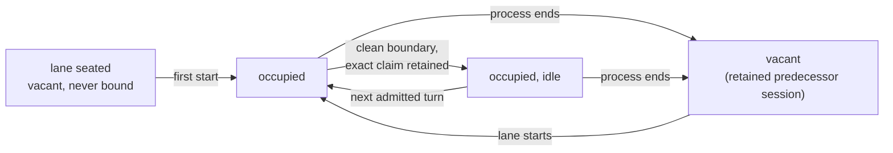

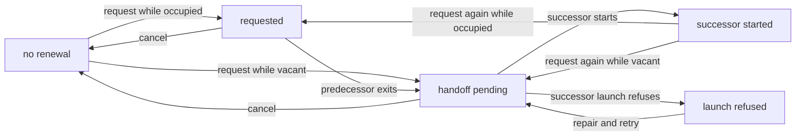

**Invariants**

- Lane is not agent. Renewal replaces the occupant; history, drafts, scroll
  position, team, and team policy survive because the lane does not move.
  Moving a lane to another team subjects it to that team's policy.
- Renewal is intent, never a start. `spice lane renew ID` records the request,
  and `spice lane renew ID --clear` withdraws it until handoff. The mark stands
  until the lane's next start consumes it. A live predecessor receives a
  private preparation notice, never a steering message, and is never forcibly
  terminated; a vacant lane's predecessor is neither started nor notified.
  The successor's briefing names its predecessor's thread. The agent's action
  menu shows a standing mark.
- Model, effort, and fast mode are seat authority that every future launch
  reads; omitting model or effort restores vendor configuration. Set fast mode
  with `spice lane fast ID on|off`, `spice team fast TEAM on|off`, or
  `spice settings fast on|off`; bare `spice settings` reads the global flag.
  Fast mode is additive: a launch runs fast when the seat, its team, or the
  global setting enables it. Lane rows report running values separately from
  seat values. A
  running OMP occupant is retuned only after the seat, team, or global change
  commits, and for fast mode only when that change flips its effective value;
  a model change restates it. A qualified model names that exact served
  provider and identity; a bare model retunes only when the running occupant's
  served catalog gives it one provider. Running values change only when the
  provider confirms. An ambiguous or absent model refuses before the seat
  changes; an unsupported occupant or interrupted request changes nothing. A
  launch states effort and fast mode only over RPC before the first turn, so
  other models' tiers follow omp; a refused effort fails it. OMP's
  no-priority-tier refusal is no vendor failure: the turn runs without fast
  mode and the lane row carries its words, toasted once. Any other fails a
  launch, or marks a model change's fast mode unconfirmed. A turn its provider
  fails only for the priority tier resumes without it; a second such refusal
  before fast mode is re-enabled ends the turn as a vendor failure. Every other
  settled provider error closes even a claim-retained process, so exit
  accounting records the provider's words and holds the lane instead of
  immediately repeating the failed prompt. Seat flags stay; later launches of
  the same model run without fast mode until it is turned on for the lane,
  team, or globally, a live fast-on confirms, or the model changes.
- A lane names one worktree; a team holds one or more lanes. Topology is server
  truth, never browser storage. Each team renders one merged stream; members
  retain concrete send addresses.
- Member zero is the main agent at the right control edge. Order controls
  composers and accents, not message chronology. Unresolved members keep their
  seats; joins append, and only explicit arrangement reorders.
- `Leave all teams` returns a member to its own lane-ID team. Departures
  preserve the source identity unless one member remains: that formation ends
  and its remaining member and subscription return to the lane-ID team
  atomically. If other occupants already hold the returning owner's ID, they
  move together to a fresh formation in that same transaction; the owner
  returns alone. No forwarding identity or durable ownership flag is needed.
- Own-ID singletons default to standard browser-local Hide team state and
  hide again on return. A lane link reveals the same team; hiding a focused
  composer releases its old permalink. Explicit reveal survives reload.
  These visibility choices do not mutate membership.
- `Create own team` and the Spice menu's `Create new team` drop target instead
  form a singleton. The resident checks topology and observed source, mints a
  fresh UUID, and carries runtime switches without a configuration-name
  binding. The singleton survives restatement. Formation IDs never derive
  from members or reuse ended identities.
- Six agents is a hard per-team limit, not an appliance-wide agent or team
  cap. Resident moves, arrangements and seating enforce it. Full teams may
  shed members or change policy.
- `wire::grouping` enforces one group per member, no empty groups, member-zero
  labels and revision-guarded faithful arrangements. Teams admit seated lanes;
  ungrouped members use their own lane-ID teams.
- Member moves, arrangements and `lane add --team` cannot add another lane to
  an own-ID team. Create an independent team first, then use that returned
  formation ID for subsequent joins. Seating into a formation keeps its ID.
  An unknown `--team` refuses unless it is the new lane's own ID; seating
  cannot invent or restore a caller-chosen formation.

---

## L-DRAFT — the watchband

**Intent.** One strip is both the status face of every agent in the team and
the writing surface for all of them.

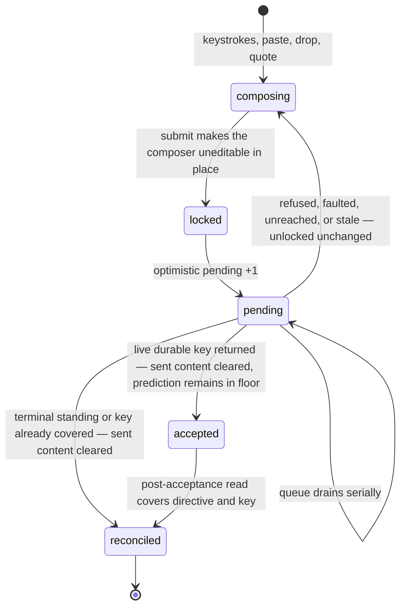

**Invariants**

- One composer column per member, in member order. Each shard is a concrete
  send address; nothing is ever broadcast to a team, so a fused submit enqueues
  one submission per nonempty shard.
- Submit locks the composer in place: body, quote drafts, and images turn
  read-only and SEND disables, so a duplicate submit moves nothing. Only durable
  acceptance clears the sent content; the direction card derives from the
  committed `steer::sent` fact. A wake, residency, or write refusal or fault,
  an unreached command, or a stale lane read unlocks it unchanged with a
  notice; transport loss replays the send still locked.
- A broadcast locks only its source composer. A source-lane branch or a
  one-target creator broadcast settles from the branch carrying that composer's
  content. A multi-target creator broadcast has no carrier: one settlement
  spans every branch and clears only after all branches settle without refusal.
- Sends drain serially per lane; a rejection drops every later queued send and
  unlocks its composer.
- The pending count is a floor over backend truth. A live acceptance keeps its
  prediction in that floor until a post-acceptance read covers the same
  directive and key; only captured identity retires it, never a decrement or a
  timeout.
- A lane's activity trace stays still between authoritative four-second
  samples. New data redraws immediately. At an elapsed sample boundary the
  existing history briefly crosses one position, and that transition's
  completion mounts the frame for the new instant; reduced motion skips the
  crossing. No animation remains active while the sampled view is unchanged.
- An unsafe draft or queued submission guards page exit with the browser's
  unload confirmation.
- A late completion never steals focus the operator has since moved.
- Image annotations stay browser-local draft state; the resident receives only
  the rendered raster.

---

## L-MESSAGE — the mosaic

**Intent.** Continuous messages must not move a reader who is inspecting older
content. Mosaic latches horizontal placement and compensates off-top readers
when vertical growth settles.

**Invariants**

- Newest content inserts without re-deciding existing spans. Older pages
  backfill downward; content changes remeasure that card; geometry changes
  replay the plane in creation order. Unchanged cards receive no style write.
- Each reader owns its retained-history cursor. Source exhaustion closes new
  reads without invalidating cached cards. Later live generations do not reopen
  it; a replacement snapshot does.
- Columns and spans stay latched between geometry replays. Liquid cards may
  settle vertically; frozen shrink retains its rows, and growth pushes
  overlapping later cards transitively through the original layout.
- Layout is a pure function of creation order, measurements, content width and
  visible viewport rows, so equal inputs replay identically.
- Normal cards measure whole-lane spans through one lane fewer than visible.
  One-lane planes and chronological boundaries remain full width.
- Placement compares committed-card movement, debt beyond one viewport, hidden
  waste and square-through-golden portrait deviation in lattice units. A small
  covered hole may avoid moving the stack; an empty plane still rejects a
  narrow multi-viewport tower.
- Forward placement never descends. A card covers any hole it creates, and its
  base becomes the floor for every later card. Only history backfills below the
  committed plane.
- Fixed-width cards use their lowest legal frontier. Equivalent choices prefer
  the smaller span, then the leftmost track.
- Tall-card measurements are batched by admitted span and retain only height or
  reading-shape improvements. Policy remains content-neutral, adds no internal
  card scrolling and stores no durable layout history.
- Pending images reserve a placeholder, then remeasure at the latched span.
  Off-top readers receive same-frame compensation; near the top, growth stays
  visible. Nothing transitions before the board settles.

---

## L-ROOM — conversation at a task

The room loop, its delivery and attention rules, and its deliberate
non-capabilities live in [rooms.md](rooms.md).

---

## The Jitter Contract

Cross-cutting: a property every loop must preserve, and the appliance's most
distinctive quality.

- **Movement means change.** Any motion the reader sees corresponds to something
  that actually changed. Re-render is not change.
- **Affordances open out of flow.** Every revealed menu, picker, overlay, and
  drag ghost opens out of the document flow, so revealing one cannot reflow the
  board.
- **Live text lives in fixed slots.** Every live label renders into a fixed-width
  single-line slot, so an update never changes a box.
- **Task counts show one open total.** Every global and team roll-up tab has one
  open-task badge. A global tab's title and accessible name report ready,
  review, active-or-in-flight, stale, blocked, and waiting-or-set-aside counts.
  Marks follow one precedence: operator-actionable blocked or environment-held
  work is danger; a Design awaiting decision is warning; an unpossessed Design
  ready for a research pass is live; deferred work is warning. The title and
  accessible name lead with the marked count. Other badges size to content;
  total tabs reserve one minimum footprint.
- **Presentation changes do not touch card identity or style.** Recolouring and
  attribution toggles force no re-measure. A member-count change that alters the
  settled host width earns one full geometry replay.
- **Programmatic scroll is not a gesture.** Compensation and restore are
  excluded from anything that reads user intent, or the surface competes with
  itself.
- **Publish each changed frame.** Every admitted stream frame that changes the
  runtime immediately updates the browser surface.
- **Unmeasurable means uncommitted.** While the surface is too narrow to
  measure, cards stay readable in ordinary flow and no lattice geometry is
  committed; a measurable reveal establishes the plane.

---

## The spice surface hierarchy

- **The console is the unit of tiling.** One peer tile per live team.
  Membership widens a console but never adds another peer console. Shared
  room traffic and Design discovery never mount a console.
- **The mosaic is the evidence layer.** Every ordinary agent card names its
  author lane and worktree in accessible attribution. A compaction card visibly
  names the configured agent or worktree leaf and carries its author lane as
  machine-readable data. Accent is redundant continuity, never the sole identity.

The [console](../app/CONSOLE.md) and [browser](../app/BROWSER.md)
contracts own concrete layout.
