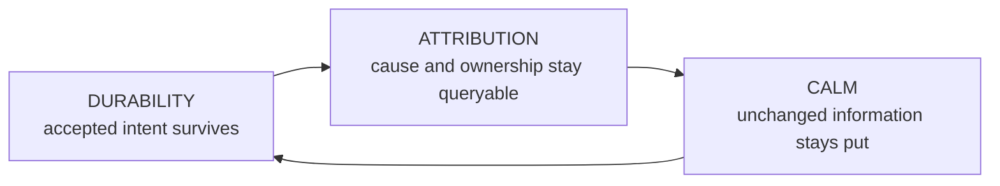

# Why Spice is valuable

Spice gives one operator a durable control plane for coding-agent work. Tasks,
steering, claims, messages, and integration evidence remain attributable, so
the operator can leave and return without using chat as the fleet's scheduler
or memory.

## Three properties

### Durability

Durability makes supervision asynchronous. Once authority accepts intent, the
operator can leave, a browser can disappear, or an agent can be replaced
without turning an instruction into recollection. Task ownership, recovery, and
integration likewise cross explicit durable boundaries instead of depending on
one process staying alive.

The exact contracts live in [identity, steering, and
work](invariants/identity.md), [integration and
lifecycle](invariants/lifecycle.md), and [session
forensics](planes/session.md).

### Attribution

Attribution makes *who changed what, and why* answerable from durable evidence.
Tasks retain their causal origin, claims retain their owner, messages retain
their speaker and destination, and claim-bound Git work retains its task
boundary.

The authority rules live in [the invariant
register](invariants.md); the concrete appliance bindings live in [the
implementation profile](implementation.md).

### Calm

Calm preserves the reader's place as live streams change. Stable identity,
reserved geometry, and explicit attribution keep several streams readable
without moving unrelated content.

The complete surface rule is [the jitter contract](loops.md#the-jitter-contract).

## Why the properties compose

Durability keeps accepted intent available across process and browser turnover.
Attribution connects that intent and its effects to actors, tasks, lanes, and
worktrees. Calm keeps unrelated presentation stable while those records change.

Together, the contracts let allocation match ready work to available lanes,
preserve claim and session continuity across occupant replacement, and attempt
independent review without making it a prerequisite for progress. The
degradation rule is [Prefer the good property, never block on
it](planes/principles.md#cross-cutting-principles).
